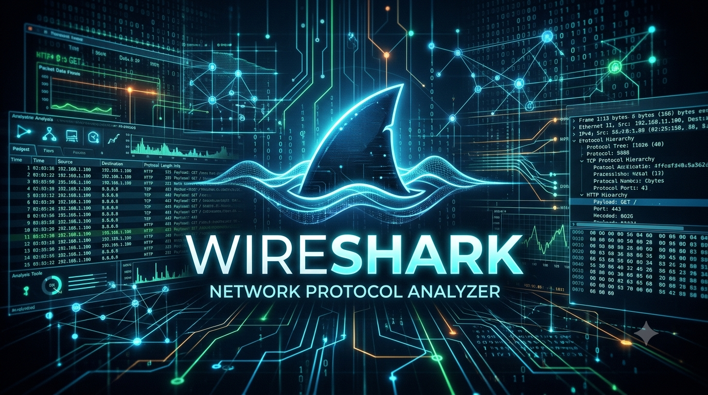
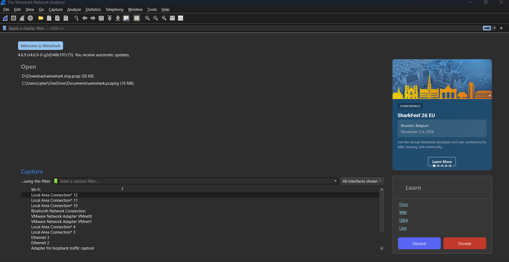
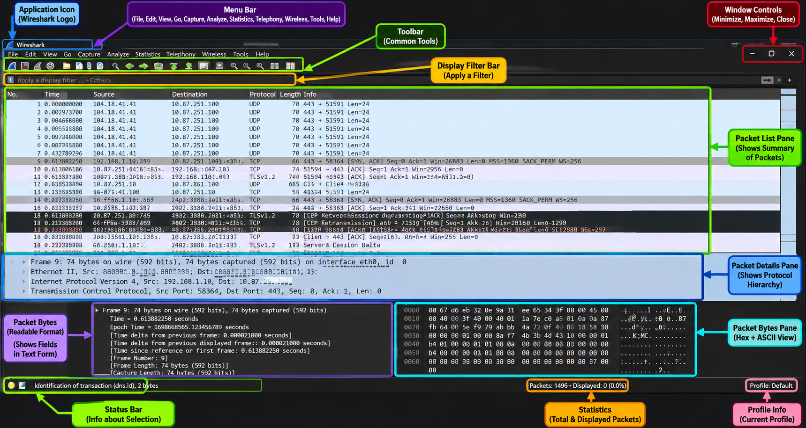
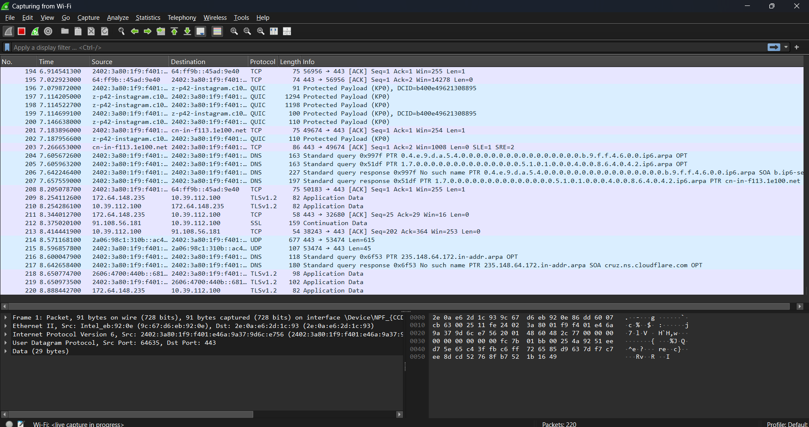
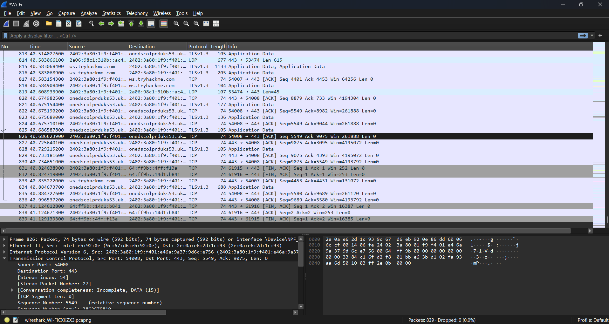
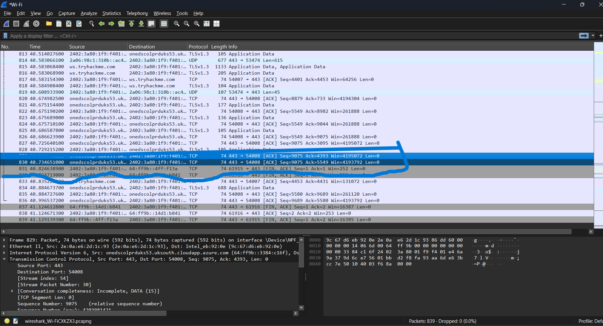
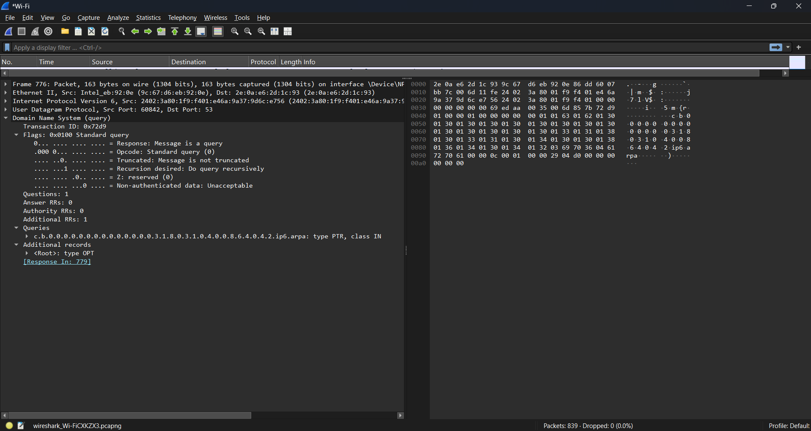
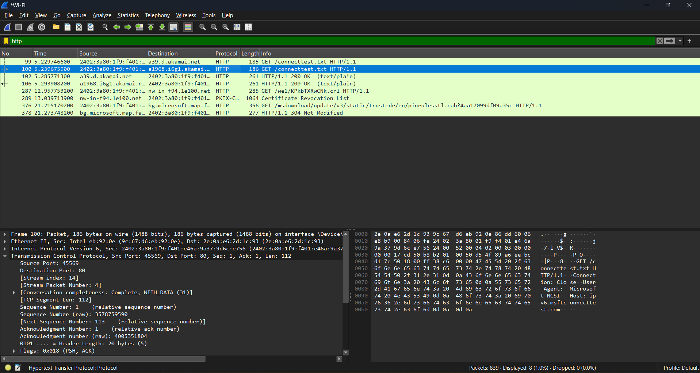
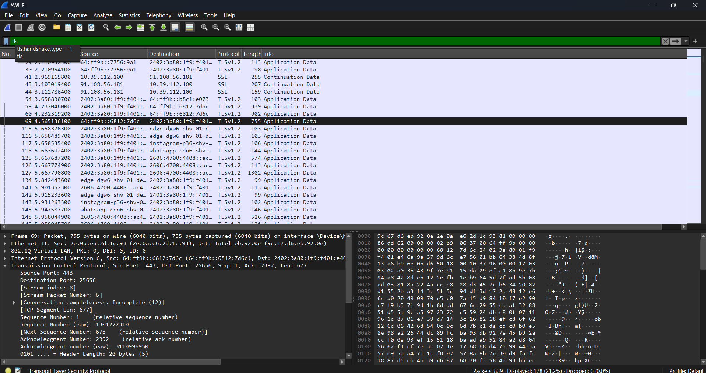
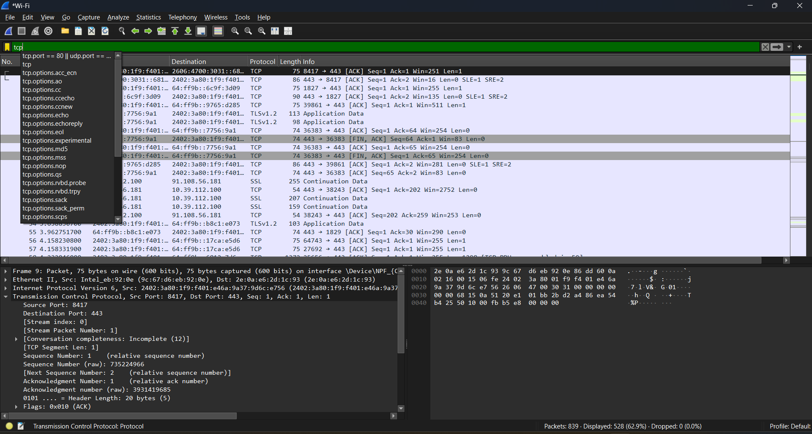

# ⚡ WIRESHARK // NETWORK TRAFFIC ANALYSIS

<div align="center">



### `Decode Packets | Analyze Protocols | Investigate Network Traffic`


**MOHIT KUMAR**

Cybersecurity Student | UPSIFS  
Cybersecurity Intern | NetworkWalks

</div>

---

## `01 // ABOUT THE PROJECT`

A practical, beginner-friendly documentation project focused on **network traffic analysis using Wireshark**.

This repository documents my learning and practical exploration of packet capture, protocol inspection, network communication, traffic filtering, and cybersecurity investigation.

### Project Objectives

- Understand how packets travel across networks.
- Analyze TCP, UDP, DNS, HTTP, HTTPS and other protocols.
- Understand the OSI and TCP/IP models.
- Explore packet capture and inspection.
- Identify unusual network communication patterns.
- Learn network troubleshooting techniques.
- Understand TCP connection establishment.
- Investigate DNS requests and responses.
- Explore HTTP and TLS communication.
- Develop practical packet analysis skills.

> The objective is not just to apply filters, but to understand what captured packets reveal about network communication.

## `02 // WHAT IS WIRESHARK?`

Wireshark is an open-source network protocol analyzer used to capture and inspect network packets.

It helps network administrators, cybersecurity students and security professionals understand network communication.

### Information Available in Wireshark

- Source IP address.
- Destination IP address.
- Source MAC address.
- Destination MAC address.
- Source and destination ports.
- Network protocols.
- TCP flags.
- DNS queries and responses.
- HTTP requests and responses.
- TLS handshake information.
- Packet timestamps.
- Packet lengths.
- Communication patterns.

### Important Features

- Live packet capture.
- Offline packet analysis.
- Display filters.
- Capture filters.
- Protocol dissection.
- Follow TCP Stream.
- Network statistics.
- Endpoint analysis.
- Conversation analysis.
- Expert Information.

## `03 // INSTALLATION AND REQUIREMENTS`

### Requirements

| Requirement | Description |
|---|---|
| Operating System | Kali Linux / Linux / Windows |
| Tool | Wireshark |
| Permission | Authorized packet capture |
| Network | Active network connection |
| Knowledge | Basic networking |

### Install on Kali Linux

```bash
sudo apt update
sudo apt install wireshark -y
```

### Check Version

```bash
wireshark --version
```

### Launch Wireshark

```bash
wireshark
```

### Launch Terminal Capture

```bash
tshark --version
```

## `04 // NETWORK INTERFACES`

A network interface is a connection point through which a system sends or receives network traffic.

### Common Network Interfaces

| Interface | Purpose |
|---|---|
| `eth0` | Ethernet interface |
| `wlan0` | Wireless interface |
| `lo` | Loopback interface |
| `any` | Supported Linux interfaces |
| `tun0` | VPN tunnel interface |
| `tap0` | Virtual Layer 2 interface |
| `docker0` | Docker virtual bridge |
| `vboxnet0` | VirtualBox host-only interface |
| `nflog` | Linux NFLOG packet source |
| `nfqueue` | Linux Netfilter queue source |

### Linux Commands

```bash
ip addr
```

```bash
ip route
```

```bash
ip link show
```

```bash
ifconfig
```

### Wireshark Capture Workflow

1. Open Wireshark.
2. Identify available interfaces.
3. Observe packet activity.
4. Select the required interface.
5. Start packet capture.
6. Apply display filters.
7. Inspect individual packets.
8. Save the capture when required.

### Screenshot



## `05 // WIRESHARK INTERFACE`

The Wireshark interface provides different sections for packet inspection.

### Main Interface Components

| Component | Purpose |
|---|---|
| Menu Bar | Access application features |
| Toolbar | Quick access to tools |
| Filter Bar | Apply display filters |
| Packet List | Display captured packets |
| Packet Details | Show protocol information |
| Packet Bytes | Display packet bytes |
| Status Bar | Show capture information |

### Packet List Columns

- No.
- Time.
- Source.
- Destination.
- Protocol.
- Length.
- Info.

### Screenshot



## `06 // PACKET CAPTURE`

Packet capture is the process of collecting network packets for inspection and analysis.

### Basic Capture Workflow

1. Open Wireshark.
2. Select a network interface.
3. Start the capture.
4. Generate normal network traffic.
5. Observe packets.
6. Apply suitable filters.
7. Stop the capture.
8. Save the capture file.

### Common Capture File Formats

| Extension | Description |
|---|---|
| `.pcap` | Packet capture file |
| `.pcapng` | Packet capture next generation |
| `.cap` | Common capture file extension |

### Useful Capture Commands

```bash
sudo tcpdump -i eth0
```

```bash
sudo tcpdump -i eth0 -w capture.pcap
```

```bash
tshark -D
```

### Screenshot



## `07 // UNDERSTANDING PACKET STRUCTURE`

A network packet contains multiple layers of information.

### Basic Packet Structure

```text
Ethernet Frame
      |
      v
IP Header
      |
      v
TCP / UDP Header
      |
      v
Application Data
```

### Important Packet Fields

| Field | Meaning |
|---|---|
| Source MAC | Sender hardware address |
| Destination MAC | Receiver hardware address |
| Source IP | Sender IP address |
| Destination IP | Receiver IP address |
| Source Port | Sending application port |
| Destination Port | Receiving application port |
| Protocol | Communication protocol |
| Length | Packet or frame length |
| TTL | IP packet lifetime limit |

### Packet Inspection

When selecting a packet, Wireshark displays:

- Frame information.
- Ethernet information.
- IP information.
- TCP or UDP information.
- Application-layer information.
- Packet bytes.

### Screenshot



## `08 // OSI MODEL`

The OSI model divides network communication into seven layers.

| Layer | Name | Examples |
|---|---|---|
| 7 | Application | HTTP, DNS |
| 6 | Presentation | Encoding, encryption |
| 5 | Session | Session management |
| 4 | Transport | TCP, UDP |
| 3 | Network | IPv4, IPv6, ICMP |
| 2 | Data Link | Ethernet, ARP |
| 1 | Physical | Cables, radio signals |

### TCP/IP Model

| Layer | Examples |
|---|---|
| Application | HTTP, DNS, TLS |
| Transport | TCP, UDP |
| Internet | IPv4, IPv6, ICMP |
| Network Access | Ethernet, Wi-Fi |

## `09 // CAPTURE FILTERS VS DISPLAY FILTERS`

Wireshark provides two major types of filters.

### Capture Filters

Capture filters determine which packets are recorded.

Examples:

```bash
host 192.168.1.10
```

```bash
net 192.168.1.0/24
```

```bash
port 80
```

```bash
tcp
```

```bash
udp
```

```bash
icmp
```

### Display Filters

Display filters are applied after packets have been captured.

Examples:

```wireshark
ip.addr == 192.168.1.10
```

```wireshark
tcp
```

```wireshark
udp
```

```wireshark
dns
```

```wireshark
http
```

```wireshark
tls
```

```wireshark
icmp
```

### Main Differences

| Capture Filter | Display Filter |
|---|---|
| Used before capture | Used after capture |
| Limits recorded traffic | Filters displayed packets |
| Uses capture filter syntax | Uses Wireshark filter syntax |
| Can reduce capture size | Does not delete packets |

## `10 // DISPLAY FILTER CHEAT SHEET`

### IP Filters

```wireshark
ip
```

```wireshark
ip.src == 192.168.1.10
```

```wireshark
ip.dst == 192.168.1.10
```

```wireshark
ip.addr == 192.168.1.10
```

```wireshark
ip.ttl < 64
```

### TCP Filters

```wireshark
tcp
```

```wireshark
tcp.port == 443
```

```wireshark
tcp.srcport == 80
```

```wireshark
tcp.dstport == 443
```

```wireshark
tcp.flags.syn == 1
```

```wireshark
tcp.flags.ack == 1
```

```wireshark
tcp.flags.reset == 1
```

```wireshark
tcp.flags.fin == 1
```

```wireshark
tcp.analysis.retransmission
```

```wireshark
tcp.analysis.duplicate_ack
```

```wireshark
tcp.analysis.zero_window
```

### UDP Filters

```wireshark
udp
```

```wireshark
udp.port == 53
```

```wireshark
udp.srcport == 53
```

```wireshark
udp.dstport == 53
```

```wireshark
udp.length > 100
```

### DNS Filters

```wireshark
dns
```

```wireshark
dns.flags.response == 0
```

```wireshark
dns.flags.response == 1
```

```wireshark
dns.qry.name
```

```wireshark
dns.qry.type == 1
```

```wireshark
dns.a
```

```wireshark
dns.aaaa
```

```wireshark
dns.cname
```

```wireshark
dns.resp.ttl
```

### HTTP Filters

```wireshark
http
```

```wireshark
http.request
```

```wireshark
http.response
```

```wireshark
http.request.method == "GET"
```

```wireshark
http.request.method == "POST"
```

```wireshark
http.response.code == 200
```

```wireshark
http.response.code == 404
```

```wireshark
http.host
```

```wireshark
http.request.uri
```

### TLS Filters

```wireshark
tls
```

```wireshark
tls.handshake
```

```wireshark
tls.handshake.type == 1
```

```wireshark
tls.handshake.type == 2
```

```wireshark
tls.handshake.extensions_server_name
```

```wireshark
tls.alert
```

### ARP Filters

```wireshark
arp
```

```wireshark
arp.opcode == 1
```

```wireshark
arp.opcode == 2
```

```wireshark
arp.src.proto_ipv4
```

```wireshark
arp.dst.proto_ipv4
```

### ICMP Filters

```wireshark
icmp
```

```wireshark
icmp.type == 8
```

```wireshark
icmp.type == 0
```

```wireshark
icmp.type == 3
```

### DHCP Filters

```wireshark
dhcp
```

```wireshark
bootp
```

## `11 // TCP THREE-WAY HANDSHAKE`

TCP establishes a connection using a three-step handshake.

### Handshake Diagram

```text
          CLIENT                 SERVER
             |                      |
             |------- SYN ---------> |
             |                      |
             | <---- SYN + ACK ----- |
             |                      |
             |------- ACK ---------> |
             |                      |
             |  CONNECTION          |
             |   ESTABLISHED         |
```

### Explanation

1. SYN: Client requests a TCP connection.
2. SYN-ACK: Server acknowledges and responds.
3. ACK: Client acknowledges the response.

### TCP Flags

| Flag | Meaning |
|---|---|
| SYN | Synchronize |
| ACK | Acknowledgment |
| FIN | Finish connection |
| RST | Reset connection |
| PSH | Push data |
| URG | Urgent pointer |

### Useful Filters

```wireshark
tcp.flags.syn == 1
```

```wireshark
tcp.flags.syn == 1 && tcp.flags.ack == 0
```

```wireshark
tcp.flags.syn == 1 && tcp.flags.ack == 1
```

```wireshark
tcp.flags.ack == 1 && tcp.flags.syn == 0
```

### Screenshot



## `12 // DNS TRAFFIC ANALYSIS`

DNS stands for Domain Name System.

It translates domain names into IP addresses.

### DNS Communication

```text
Client
   |
   | DNS Query: example.com
   |
   v
DNS Resolver
   |
   | DNS Response
   |
   v
Client
```

### DNS Record Types

| Record | Purpose |
|---|---|
| A | IPv4 address |
| AAAA | IPv6 address |
| CNAME | Domain alias |
| MX | Mail server |
| NS | Name server |
| TXT | Text information |
| SOA | Zone authority |
| PTR | Reverse DNS |
| SRV | Service location |

### DNS Investigation Filters

```wireshark
dns
```

```wireshark
dns.flags.response == 0
```

```wireshark
dns.flags.response == 1
```

```wireshark
dns.qry.name contains "example"
```

```wireshark
dns.a
```

```wireshark
dns.cname
```

```wireshark
dns.flags.rcode != 0
```

### What to Investigate

- Which domain was requested?
- Which client generated the query?
- Which DNS server received it?
- What response was returned?
- Was the query successful?
- Were unusual queries observed?

### Screenshot



## `13 // HTTP AND HTTPS ANALYSIS`

HTTP is an application-layer protocol used for web communication.

HTTPS adds TLS encryption to protect communication.

### Common HTTP Methods

| Method | Purpose |
|---|---|
| GET | Retrieve data |
| POST | Submit data |
| PUT | Update or create resource |
| DELETE | Delete resource |
| HEAD | Retrieve response headers |

### Common HTTP Status Codes

| Code | Meaning |
|---|---|
| 200 | OK |
| 301 | Moved Permanently |
| 302 | Found |
| 400 | Bad Request |
| 401 | Unauthorized |
| 403 | Forbidden |
| 404 | Not Found |
| 500 | Internal Server Error |
| 503 | Service Unavailable |

### HTTP Filters

```wireshark
http
```

```wireshark
http.request
```

```wireshark
http.response
```

```wireshark
http.request.method == "GET"
```

```wireshark
http.request.method == "POST"
```

```wireshark
http.response.code == 200
```

```wireshark
http.response.code == 404
```

```wireshark
http.host
```

```wireshark
http.request.uri
```

### HTTPS / TLS Filters

```wireshark
tls
```

```wireshark
tls.handshake
```

```wireshark
tls.handshake.type == 1
```

```wireshark
tls.handshake.extensions_server_name
```

### Security Note

HTTPS application payloads are normally encrypted.

A packet capture alone does not reveal passwords or cookies inside encrypted HTTPS traffic.

### Screenshot



## `14 // TLS HANDSHAKE ANALYSIS`

TLS stands for Transport Layer Security.

It protects data exchanged between communicating systems.

### Common TLS Handshake Messages

| Message | Purpose |
|---|---|
| Client Hello | Client starts negotiation |
| Server Hello | Server selects parameters |
| Certificate | Server identity information |
| Finished | Confirms handshake completion |

### Useful Filters

```wireshark
tls
```

```wireshark
tls.handshake
```

```wireshark
tls.handshake.type == 1
```

```wireshark
tls.handshake.type == 2
```

```wireshark
tls.alert
```

### What to Inspect

- Client Hello.
- Server Hello.
- TLS version.
- Cipher suite.
- Server certificate.
- Server Name Indication.
- Handshake messages.

### Screenshot



## `15 // PORT SCANNING INDICATORS`

Port scanning is used to discover available network services.

Wireshark can help identify patterns associated with scanning activity.

### Common Indicators

- One source contacting multiple destination ports.
- Repeated TCP SYN packets.
- Repeated connection attempts.
- RST responses.
- Unusual connection frequency.

### Investigation Filters

```wireshark
tcp.flags.syn == 1 && tcp.flags.ack == 0
```

```wireshark
tcp.flags.reset == 1
```

```wireshark
tcp.flags.syn == 1 && tcp.analysis.retransmission
```

### Investigation Workflow

1. Identify the source IP.
2. Identify the destination IP.
3. Examine destination ports.
4. Inspect TCP flags.
5. Compare timestamps.
6. Review repeated connection patterns.
7. Document findings.

> A SYN packet alone does not prove an attack. Always investigate the surrounding context.

## `16 // BRUTE-FORCE TRAFFIC ANALYSIS`

Brute-force attacks involve repeated authentication attempts.

### Possible Network Indicators

- Repeated login requests.
- Multiple authentication attempts.
- Repeated connections from one source.
- HTTP 401 responses.
- HTTP 403 responses.
- Unusual request frequency.

### Useful Filters

```wireshark
http.request.method == "POST"
```

```wireshark
http.response.code == 401
```

```wireshark
http.response.code == 403
```

### Investigation Workflow

1. Identify the application protocol.
2. Locate authentication-related requests.
3. Identify source and destination.
4. Inspect timestamps.
5. Examine response codes.
6. Compare request frequency.
7. Document suspicious patterns.

A POST request alone is not evidence of brute-force activity.

## `17 // ADVANCED WIRESHARK FEATURES`

| Feature | Purpose |
|---|---|
| Follow TCP Stream | Inspect TCP conversation |
| Follow UDP Stream | Inspect UDP conversation |
| Expert Information | Highlight communication issues |
| Decode As | Select another protocol dissector |
| Packet Comments | Add investigation notes |
| Name Resolution | Display resolved hostnames |
| Time Display Format | Change timestamps |

### Useful Statistics Menus

- Statistics → Protocol Hierarchy
- Statistics → Conversations
- Statistics → Endpoints
- Statistics → I/O Graphs
- Statistics → Packet Lengths
- Statistics → Flow Graph

## `18 // NETWORK TROUBLESHOOTING`

### Common Problems

| Problem | Possible Explanation |
|---|---|
| TCP Retransmission | Segment was not acknowledged in time |
| Duplicate ACK | Receiver reports a missing segment |
| TCP Reset | Connection was reset |
| DNS Failure | Name resolution failed |
| Destination Unreachable | Network or host unreachable |
| High Latency | Delayed network response |
| Packet Loss | Possible connectivity issue |

### Useful Filters

```wireshark
tcp.analysis.retransmission
```

```wireshark
tcp.analysis.duplicate_ack
```

```wireshark
tcp.flags.reset == 1
```

```wireshark
dns.flags.rcode != 0
```

```wireshark
icmp.type == 3
```

## `19 // PRACTICAL INVESTIGATION WORKFLOW`

```text
                 START
                   |
                   v
           SELECT INTERFACE
                   |
                   v
            CAPTURE TRAFFIC
                   |
                   v
          IDENTIFY PROTOCOLS
                   |
                   v
         APPLY DISPLAY FILTERS
                   |
                   v
            INSPECT PACKETS
                   |
                   v
        IDENTIFY SOURCE / DEST
                   |
                   v
          FOLLOW CONNECTIONS
                   |
                   v
       CHECK UNUSUAL PATTERNS
                   |
                   v
          ANALYZE STATISTICS
                   |
                   v
          DOCUMENT FINDINGS
                   |
                   v
                  END
```

### Investigation Checklist

- [ ] Identify source IP.
- [ ] Identify destination IP.
- [ ] Identify source port.
- [ ] Identify destination port.
- [ ] Determine the protocol.
- [ ] Examine TCP flags.
- [ ] Inspect DNS queries.
- [ ] Inspect DNS responses.
- [ ] Examine HTTP traffic.
- [ ] Inspect TLS handshakes.
- [ ] Identify unusual connections.
- [ ] Review timestamps.
- [ ] Analyze conversations.
- [ ] Document findings.

## `20 // SCREENSHOT GALLERY`

This section contains screenshots from my Wireshark learning and packet analysis sessions.

### 00. Cybersecurity Banner


### 01. Wireshark Interface


### 02. Network Interfaces


### 03. Packet Capture


### 04. Packet Details


### 05. TCP Three-Way Handshake


### 06. DNS Traffic Analysis


### 07. HTTP Traffic Analysis


### 08. TLS Handshake


### 09. Display Filters



## `21 // LEARNING RESOURCES`

- [Official Wireshark Website](https://www.wireshark.org/)
- [Wireshark Documentation](https://www.wireshark.org/docs/)
- [Display Filter Reference](https://www.wireshark.org/docs/dfref/)
- [Wireshark User Guide](https://www.wireshark.org/docs/wsug_html_chunked/)
- [Wireshark Sample Captures](https://wiki.wireshark.org/SampleCaptures)

## `22 // ETHICAL USE AND DISCLAIMER`

This repository is created for educational purposes and authorized network analysis.

- Capture only traffic you own or have permission to inspect.
- Respect network privacy.
- Do not expose credentials or personal information.
- Do not inspect private traffic without authorization.
- Verify findings before reporting suspicious activity.
- Use Wireshark responsibly.

## `23 // AUTHOR`

<div align="center">

# MOHIT KUMAR

**Cybersecurity Student**

Uttar Pradesh State Institute of Forensic Sciences (UPSIFS)

**Cybersecurity Intern | NetworkWalks**

### LEARN. ANALYZE. INVESTIGATE. IMPROVE.

`[ EVERY PACKET HAS A STORY. LEARN TO READ IT. ]`

</div>

---

<div align="center">

**⭐ If this repository helps you understand network traffic analysis, consider giving it a star!**

**THANK YOU FOR VISITING MY REPOSITORY**

</div>